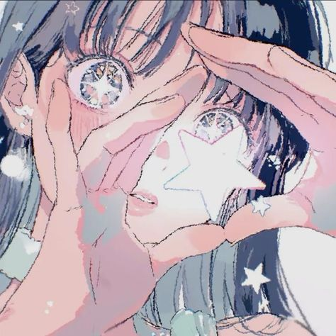
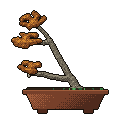

### WIP, IGNORE ME (NOT FINISHED)!!!
<div align="center">
  
</div>




```text
maxdelmed@github
-------------------------
- Universidad Fidélitas
      Ingeniería en Sistemas

Este perfil es para Proyectos universitarios y
proyectos personales de software.
```

[Proyectos](#proyectos) · [Tecnologías](#tecnologías) · [Carrd](https://wadwool.carrd.co)

<br clear="left">

<h2 align="left">📇 Tecnologies</h2>


<p>
  
  
  
  
  
</p>
<p>
  
  
  
  
  
</p>
<p>
  
  
  
  
  
</p>
<p>
  
  
  
</p>

<br clear="right">

<h2 align="center">⌨️ Proyects !! </h2>

<p align="center"></p>

### Personal Projects (WIP, not everything is added yet oops. Still merging from old acc)
## ESP
- **Mis finanzas** · App web para registrar gastos en colones y llevar un presupuesto mensual [Test](https://maxdelmed.github.io/wwwrld-finanzas/).
- **Sala de estudio** · Sala en línea con chat y temporizador compartido.
- **Magicite Mod** · Mod basado en el uso de magia de Final Fantasy Crystal Chronicles | Forge 1.20.1.
- **Recapping for Discord** · Bot para Discord que resume conversaciones en el canal que le pidan.
- **Outfit Atelier** · Mod para la creación de prendas de ropa completamente custom desde dentro del servidor host | Forge 1.20.1.
- **Stained Glass Studio** · Creación de vidrieras personalizadas con enfoque en el rendimiento | Forge 1.20.1
- **Custom Shop Signs** · Como su nombre indica, es un mod que añade diversas formas de crear y personalizar letreros, permitiéndote
- **Player Bounty Boards** · Complemento para *Bountiful*. Añade la posibilidad de crear recompensas y objetivos personalizados.
- **Restaurant Menus** · ---
- **Ship in a Bottle** · ---
- **Caravan Contracts** · ---
- **Moving Day Crates** · ---
- **Waystone Charts** · ---
- etc (WIP)

## ENG
- **Mis finanzas** · Web app made to register expenses in "colones" and to track a monthly budget [Test](https://maxdelmed.github.io/wwwrld-finanzas/).
- **Sala de estudio** · Online room with a shared timer.
- **Magicite Mod** · Mod based on Final Fantasy Crystal Chronicles' magic use | Forge 1.20.1.
- **Recapping for Discord** · Discord bot made to summarize conversations in any channel.
- **Outfit Atelier** · Mod that adds complete custom clothing creation from within the server | Forge 1.20.1
- **Stained Glass Studio** · Performance first custom stained glassmaking | Forge 1.20.1
- **Custom Shop Signs** · As the name implies, it is a mod that adds a variety of ways to make and stamp a sign so you can decorate as you wish with them | Forge 1.20.1
- **Player Bounty Boards** · Bountiful Addon. Adds the ability to make custom bounties and rewards.
- **Restaurant Menus** · ---
- **Ship in a Bottle** · ---
- **Caravan Contracts** · ---
- **Moving Day Crates** · ---
- **Waystone Charts** · ---
- etc (WIP)

<h2 align="right">📝 Links</h2>


<p align="center"><a href="https://wadwool.carrd.co"><b>Wadley Wool · Carrd</b></a></p>
<p align="center"><a href="https://wadwool.carrd.co"><b>Wadley Wool · Carrd</b></a></p>
<p align="center"><a href="https://wadwool.carrd.co"><b>Wadley Wool · Carrd</b></a></p>
<p align="center"><a href="https://wadwool.carrd.co"><b>Wadley Wool · Carrd</b></a></p>

<br clear="left">

<p align="center"></p>

<h2 align="center">⚔️ Activity !!</h2>


<p align="center">
  <a href="https://github.com/egorthinks/git-bonsai">
    
  </a>
</p>
<p align="center">
  
</p>

<h2 align="center">💖 Thank you for reading my profile! As a thank you gift I've prepared a Pokémon Wordle-type game below. You're free to play it whenever you want! I'll try making it better whenever I have the time.</h2>

<p align="center">
  <a href="https://maxdelmed.github.io/daily-dex/">
    
  </a>
</p>

<p align="center"></p>
