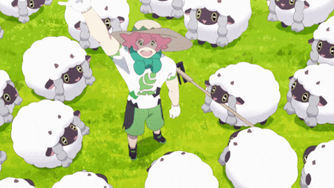
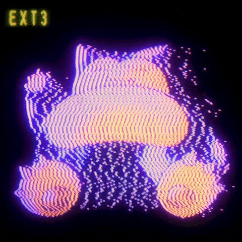

### WIP, IGNORE ME (NOT FINISHED)!!!
<div align="center">
  
</div>


```text
maxdelmed@github
-------------------------
- Universidad Fidélitas
      Ingeniería en Sistemas

Este perfil es para Proyectos universitarios y
proyectos personales de software.
```

[Proyectos](#proyectos) · [Tecnologías](#tecnologías) · [Carrd](https://wadwool.carrd.co)

<br clear="left">

<h2 align="left">📇 Tecnologies</h2>


<p>
  
  
  
  
  
</p>
<p>
  
  
  
  
  
</p>
<p>
  
  
  
  
  
</p>
<p>
  
  
  
</p>

<br clear="right">

## Proyectos

<p align="center">
  
</p>

<p align="center"><strong><code>▶ SELECT A PROJECT</code></strong></p>

| Project | Description |
| --- | --- |
| [](https://github.com/maxdelmed/Magicite-Echoes) | A Minecraft Forge 1.20.1 mod inspired by the magic system in Final Fantasy Crystal Chronicles. |
| [](https://github.com/maxdelmed/Moving-Day-Crates) | Moving day! Use crates to pack chests and other container furniture and take them with you to your new home. |

<details>
<summary><strong>More projects</strong></summary>

**Web & Discord**

- **Sala de estudio** · Online study room with chat and a shared timer.
- **Recapping for Discord** · A bot that summarizes conversations in a selected Discord channel.

**Minecraft mods · Forge 1.20.1**

- **Outfit Atelier** · Design custom outfits in-game on a server.
- **Stained Glass Studio** · Make custom stained-glass designs with a focus on performance.
- **Custom Shop Signs** · Create and customize signs for shops.
- **Player Bounty Boards** · A Bountiful add-on for creating custom bounties and rewards.

</details>

<details>
<summary><strong>Ver en español</strong></summary>

**Destacados**

- **[Magicite Echoes](https://github.com/maxdelmed/Magicite-Echoes)** · Mod basado en el uso de magia de Final Fantasy Crystal Chronicles para Forge 1.20.1.
- **[Moving Day Crates](https://github.com/maxdelmed/Moving-Day-Crates)** · ¡Día de mudanza! Usa cajas para empacar cofres y otros muebles de almacenamiento y llevarlos a tu nueva casa.

**Web y Discord**

- **Sala de estudio** · Sala en línea con chat y temporizador compartido.
- **Recapping for Discord** · Bot que resume conversaciones de un canal seleccionado de Discord.

**Mods de Minecraft · Forge 1.20.1**

- **Outfit Atelier** · Diseño de atuendos personalizados dentro del juego en un servidor.
- **Stained Glass Studio** · Diseño de vidrieras personalizadas con enfoque en el rendimiento.
- **Custom Shop Signs** · Creación y personalización de letreros para tiendas.
- **Player Bounty Boards** · Complemento para Bountiful que permite crear objetivos y recompensas personalizados.

</details>

<details>
<summary><strong>On the workbench · En el taller</strong></summary>

- Restaurant Menus
- Ship in a Bottle
- Caravan Contracts
- Waystone Charts

</details>


<h2 align="right">📝 Links</h2>


<p align="center"><a href="https://wadwool.carrd.co"><b>Wadley Wool · Carrd</b></a></p>
<p align="center"><a href="https://wadwool.carrd.co"><b>Wadley Wool · Carrd</b></a></p>
<p align="center"><a href="https://wadwool.carrd.co"><b>Wadley Wool · Carrd</b></a></p>
<p align="center"><a href="https://wadwool.carrd.co"><b>Wadley Wool · Carrd</b></a></p>

<br clear="left">

<p align="center"></p>

<h2 align="center">⚔️ Activity !!</h2>


<p align="center">
  <a href="https://github.com/egorthinks/git-bonsai">
    
  </a>
</p>
<p align="center">
  
</p>

<h2 align="center">💖 Thank you for reading my profile! As a thank you gift I've prepared a Pokémon Wordle-type game below. You're free to play it whenever you want! I'll try making it better whenever I have the time.</h2>

<p align="center">
  <a href="https://maxdelmed.github.io/daily-dex/">
    
  </a>
</p>

<p align="center"></p>
