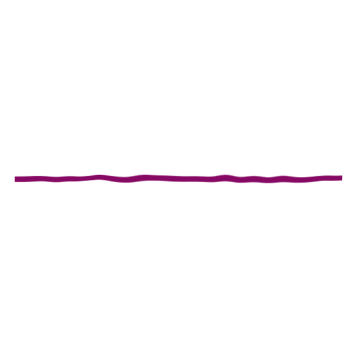

<div align="center">
  
</div>




```text
maxdelmed@github
-------------------------
🏫 Universidad Fidélitas
💻 Ingeniería en Sistemas
📁 Trabajos de la U
🛠️ Proyectos personales de software
```

[Proyectos](#proyectos) · [Tecnologías](#tecnologías) · [Carrd](https://wadwool.carrd.co)

<br clear="left">

<h2 align="left">📇 Tecnologías</h2>


<p>
  
  
  
  
</p>
<p>
  
  
  
  
</p>
<p><b>También:</b> TypeScript, Java, Python, PHP, C#, NestJS, Next.js, Flask, Docker, Nginx, Redis y Supabase.</p>

<br clear="right">

<h2 align="center">⌨️ Proyectos 🖱️</h2>

<p align="center"></p>

### Trabajos de la U

**Quantik** · Juego de tablero en ensamblador x86 para DOS con guardado de partidas.

### Proyectos personales

- **Mis finanzas** · App web para registrar gastos en colones y llevar un presupuesto mensual. [Abrir app](https://maxdelmed.github.io/wwwrld-finanzas/).
- **Sala de estudio** · Sala en línea con chat y temporizador Pomodoro compartido.
- **Magicite Mod** · Mod para Minecraft Forge con cristales coleccionables y hechizos cooperativos.
- **Recapping for Discord** · Bot que resume conversaciones para ponerse al día en Discord.

<h2 align="right">📝 Enlaces</h2>


<p align="center"><a href="https://wadwool.carrd.co"><b>Wadley Wool · Carrd</b></a></p>

<br clear="left">

<p align="center"></p>

<h2 align="center">⚔️ Actividad de GitHub 🛡️</h2>


<p align="center">
  
  <br>
  
</p>

<br clear="right">

<p align="center"><a href="https://github.com/egorthinks/git-bonsai"></a></p>

<h2 align="center">💖 Thank you!! 💖</h2>

<p align="center"></p>
